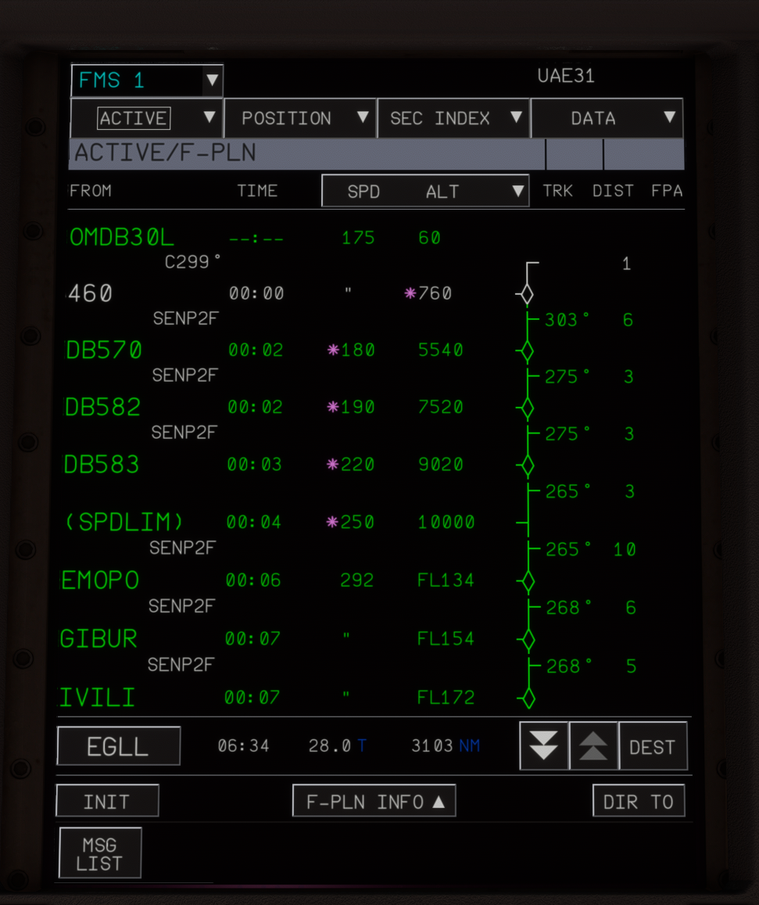
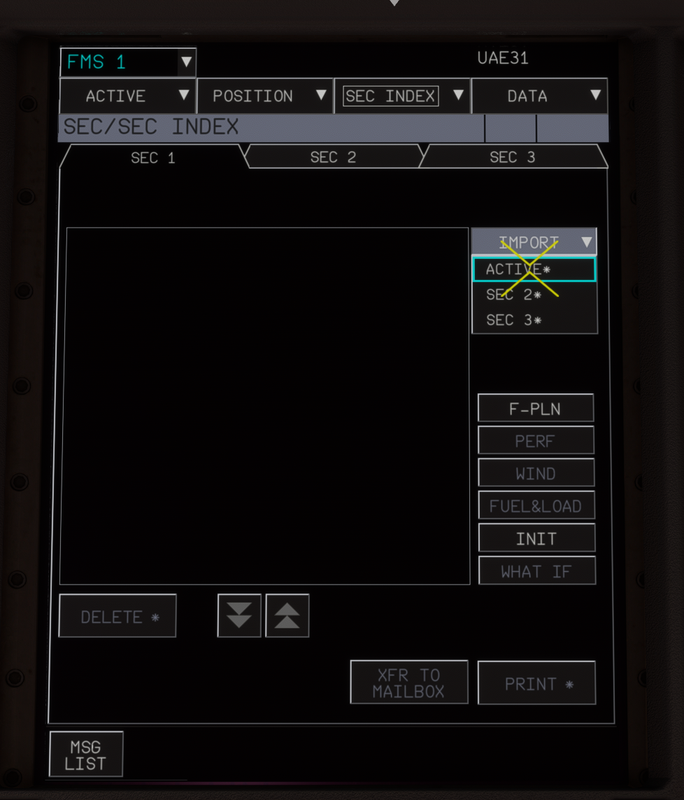
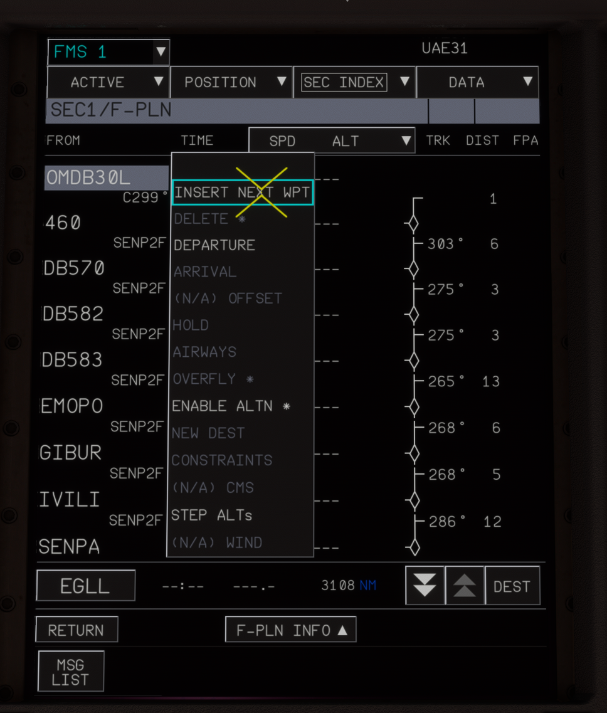

# Secondary Flight Plan

The A380X now supports creating up to three secondary flight plans. This is a flight plan that exists in parallel with the primary flight plan.
On the A380, Secondary flight plans are primarily used to plan returns to the departure airfield, runway changes, or emergency scenarios in advance and can be activated when needed. In this section of the guide, we will go over example use cases for this feature.

??? info "Recommendations"

    It is recommended to use SEC 1 for an immediate return to the departure airfield and SEC 2 for alternate runway or procedure planning. SEC 3 should be left empty and dedicated to any route uplinks.

## Engine-out Departure Procedure
### Preparation

In real life, one of the most common use cases for the secondary flight plan is programming an alternative departure procedure in case of an engine failure at takeoff. For this guide, we assume that the FMS has been set up for a flight from Dubai International Airport (OMDB) to London Heathrow Airport (EGLL). In the primary flight plan, we have planned a departure from runway 30L following the SENP2F SID.

{loading=lazy}

Due to the steep initial climb gradient requirements and airspace constraints in the vicinity of the airport, we cannot follow our planned SID out of Runway 30L in the event of an engine failure. Instead, we follow an alternative Engine-Out SID (EOSID) procedure.

To program this in the secondary flight plan, we start by creating a copy of the active flight plan. We start on the SEC INDEX page, and then import our primary flight plan using the IMPORT button. This is one way of This is one way to create a secondary flight plan. Another option is to create one from scratch using the INIT button, or perform a CPNY F-PLN request.

{loading=lazy}

First, we remove the SID and import our Engine Out SID. We do this by clicking the F-PLN button, and then clicking on our departure runway. We can then select insert next waypoint.

For our Engine Out SID, we will climb on runway track 354° to our engine-out acceleration altitude, continue on the runway track 354° to 25 NM, and enter a holding pattern. For this, we enter `OMDB30L/299/25` as our waypoint, and then add a holding pattern at this waypoint.

{loading=lazy}

We can now prepare the arrival back into Istanbul. We can do this by selecting the PDB01 waypoint, and select NEW DEST. There, we type OMDB and enter it as our new destination. Then, we select an ILS approach to runway 30L. At this point, we have a rough flight plan programmed, and we can review the ND to confirm that it makes sense.

## Activating the Secondary Flight Plan

the