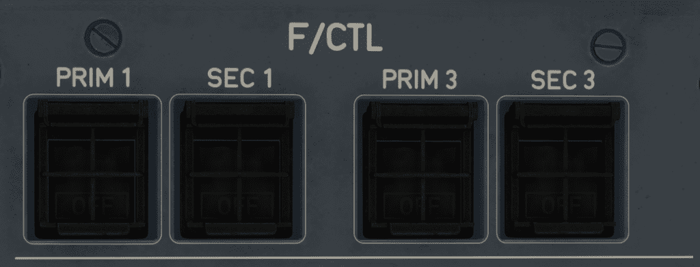
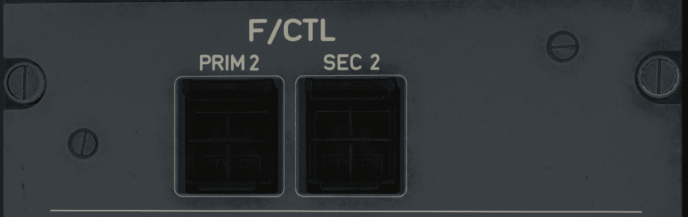

# Flight Control System Panel

---

[Back to Overhead](../overviews/ovhd.md){ .md-button }

---

## Left Side
{loading=lazy}

## Right Side
{loading=lazy}

!!! note "API Documentation: [FLT CTL Panel API](../../../../../aircraft/a380x/a380x-api/a380x-flight-deck-api.md#fctl-panel)"

## Description

The flight control system is a fly-by-wire system.

All the flight control surfaces are:

- Electrically controlled,
- Hydraulically actuated. 
  The surfaces are actuated by one of the two hydraulic systems, or by an independent hydraulic
  source (EHA/EBHA). 
  Note: The slats also have an electrical motor.

The flight crew uses sidesticks and rudder pedals to fly the aircraft. The flight control computers
interpret the pilot's inputs, and order flight control surface movement, as necessary.
Additionally, a pitch trim switch and a rudder trim selector (with a rudder trim reset p/b) allow to trim the
airplane when needed.

## Usage

### PRIM pb-sw

- ON (not illuminated):
    - The corresponding PRIM is on.
- OFF:
    - The corresponding PRIM is off.
    - Switching it OFF then on resets it.
- FAULT:
    - The corresponding PRIM is failed.
    - Associated with the following ECAM alert:F/CTL PRIM 1(2)(3) FAULT:
    - The FAULT light goes off when the flight crew selects OFF.
    - The FAULT light flashes during the PRIM safety test.

### SEC pb-sw

- ON (not illuminated):
    - The corresponding SEC is on.
- OFF:
    - The corresponding SEC is off.
    - Switching it OFF then on resets it.
- FAULT:
    - The corresponding SEC is failed. 
    - Associated with the following ECAM alert: F/CTL SEC 1(2)(3) FAULT.
    - The FAULT light goes off when the flight crew selects OFF.
    - The FAULT light flashes during the SEC safety test.

---

[Back to Overhead](../overviews/ovhd.md){ .md-button }

---
